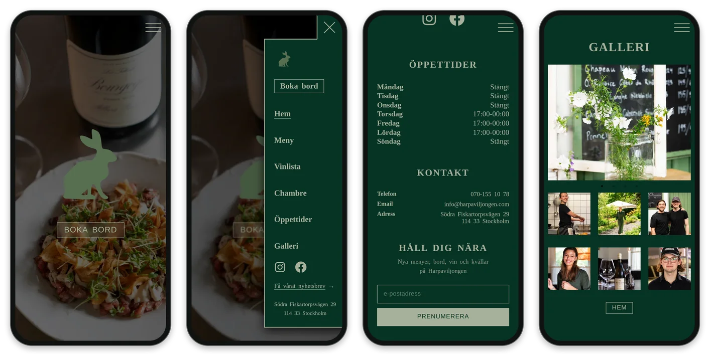
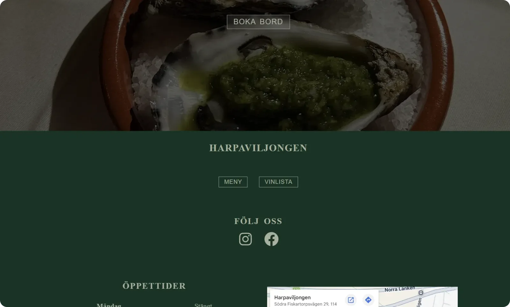
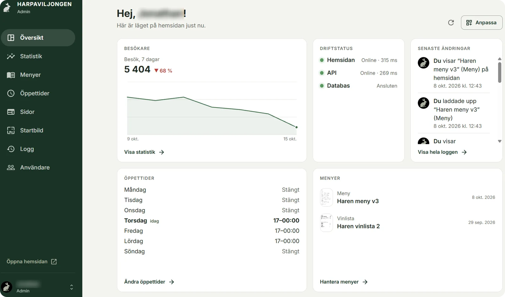
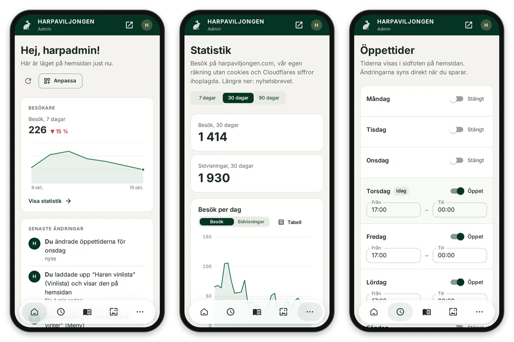
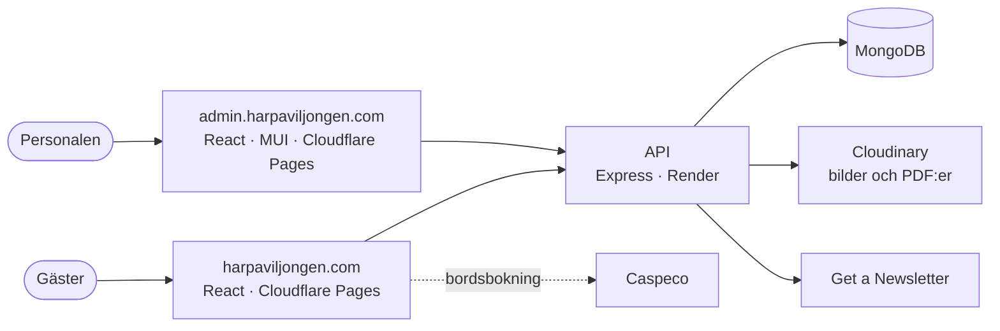

<p align="center">
  
</p>

<h1 align="center">Harpaviljongen</h1>

<p align="center">
  Hemsidan för restaurangen Harpaviljongen i Stockholm.<br>
  <a href="https://harpaviljongen.com"><strong>harpaviljongen.com</strong></a>
</p>

<p align="center">
  
  
  
  
  
</p>

<p align="center">
  
</p>

## 🐇 Om sidan

Byggd med React av David Åkerlind 2025-2026. Hemsidan har en startsida, meny, vinlista, Chambre séparée, galleri och evenemang. Den ligger på Cloudflare Pages och bygger automatiskt från `main`.

Allt som ändras ofta (menyer, öppettider, bilderna på startsidan och vilka sidor som syns) hämtas från ett eget API på Render med en MongoDB-databas. Personalen ändrar det i en egen admin på admin.harpaviljongen.com, med inloggning och två roller (admin och personal).

## 📱 I mobilen

<p align="center">
  
</p>

## 🖥️ På datorn

<p align="center">
  
</p>

## ⚙️ Admin

Här byter personalen meny-PDF:er och öppettider, väljer bilderna på startsidan, visar eller döljer sidor och följer besöken. Allt syns på hemsidan direkt.

<p align="center">
  
</p>

<p align="center">
  
</p>

| I admin | Vad man gör där |
|---|---|
| **Menyer** | Ladda upp menyn och vinlistan som PDF och välj vilken som visas. Egna menyer (t.ex. *Lunchmeny*) får egna knappar. |
| **Öppettider** | Visas i sidfoten på hemsidan. |
| **Sidor** | Visa eller dölj Chambre, Evenemang och Galleri i menyn och på startsidan. |
| **Startbild** | Bilderna i bildspelet högst upp på startsidan: vilka, i vilken ordning och hur länge. |
| **Statistik** | Besök och sidvisningar (egen räkning ihop med Cloudflares) och nyhetsbrevet. |
| **Logg** | Vem som ändrade vad och när. |
| **Användare** | Konton för personalen (bara för admin). |

## 🧭 Så hänger det ihop



## 🔧 Så funkar det

<details>
<summary><strong>Styrs från admin</strong></summary>

Knapparna *Meny* och *Vinlista* (i menyn och på startsidan) öppnar den PDF som är vald i admin (admin.harpaviljongen.com). Om ingen är vald öppnas `Ny_meny_kommer_snart.pdf`. Menyer som skapas i admin (t.ex. *Lunchmeny*) får egna knappar, men bara när en PDF är vald för dem. I admin väljer man också om varje menyknapp ska synas i menyn och/eller på startsidan. Länkarna och knapparna till Chambre, Evenemang och Galleri visas eller döljs också därifrån. Sidan hämtar detta från `/api/site-config` en gång per besök och sparar det i webbläsaren. Den väntar aldrig på API:t.

</details>

<details>
<summary><strong>Besöksstatistik</strong></summary>

På harpaviljongen.com skickar sidan en liten anonym räkning till API:t för varje sidvisning (`POST /api/site-config/seen`): bara sidans adress och vilken sida besökaren kom från. Inga cookies, inget sparas i webbläsaren och ingen IP-adress sparas. Siffrorna visas under *Statistik* i admin, ihoplagda med Cloudflares siffror om det är kopplat. Cloudflares siffror räknar bara sidorna som finns i `PAGES` i API:ts `services/cloudflareAnalytics.js`, så lägg till en ny sida där också. Lokalt räknas inget, om du inte sätter `VITE_ANALYTICS=on` i `.env.local` (se `src/components/PageViews/PageViews.jsx`).

</details>

<details>
<summary><strong>Bildspelet på startsidan</strong></summary>

Startsidans hero är ett bildspel som styrs från admin (**Startbild**): vilka bilder som visas, i vilken ordning, vilken som visas först, tid per bild (5–30 s), slumpad ordning eller bildspelet av (då visas bara den första bilden). Hemsidan läser det från `GET /api/site-config` (`hero`) och sparar det i webbläsaren, så en återkommande besökare ser rätt bilder direkt. Bilderna ligger i Cloudinary, som ger varje skärm rätt bredd och format (WebP/AVIF). Logiken finns i `src/components/HeroSection/useHero.js` och `HeroSlideshow.jsx`.

Bildspelet pausar när det inte syns (annan flik, bortskrollat). Det går även för besökare som valt mindre rörelse i sin enhet, eftersom bilderna bara tonar över i varandra.

**Inbyggda bilder:** tills bilder har laddats upp i admin, och om API:t inte svarar vid ett första besök (efter 1,5 s), visas hemsidans egna bilder i `src/components/HeroSection/heroSlides.js`, med admin-inställningarna när de är kända. Byta eller lägga till en inbyggd bild: lägg originalbilden (så stor som möjligt, t.ex. `7-terrassen.jpg`) i en mapp och kör `node scripts/hero-images.mjs <mappen>`. Skriptet gör WebP-filer i flera bredder i `src/assets/pictures/hero/`, och webbläsaren hämtar den som passar skärmen. Lägg sedan till namnet (`7-terrassen`) i `heroSlides.js`.

</details>

<details>
<summary><strong>Nyhetsbrev</strong></summary>

- **Popupen:** restaurangens popup-formulär från Get a Newsletter laddas på varje sida (skriptet ligger i `<head>` i `index.html`). Hur popupen ser ut, när den visas (t.ex. efter några sekunder) och hur ofta ställs in i Get a Newsletter-kontot.
- **Fältet i sidfoten** på startsidan: e-post och **Prenumerera** (sist på datorn, ovanför kartan på mobilen, där knappen ligger under fältet). Adressen skickas till API:t (`POST /api/newsletter`), som lämnar den vidare till ett prenumerationsformulär i Get a Newsletter. Fältet visas inte när API:t säger att det inte är kopplat än (`newsletter: false` i `/api/site-config`). Se `src/components/Newsletter/Newsletter.jsx` och docs/GO_LIVE.md i API:t.
- **"Få vårat nyhetsbrev →"** i hamburgermenyn, ovanför adressen: leder än så länge till fältet i sidfoten (`/#nyhetsbrev`).

</details>

<details>
<summary><strong>Säkerhetshuvuden (<code>public/_headers</code>)</strong></summary>

Cloudflare Pages skickar med det här på varje sida:

- `X-Content-Type-Options`, `Referrer-Policy`, `Strict-Transport-Security` (bara HTTPS) och `X-Frame-Options: SAMEORIGIN`, så att andra webbplatser inte kan visa hemsidan i en ram.
- En **Content-Security-Policy** med bara regler som inte kan påverka besökarna: inga plugins, ingen `<base>` och ingen inramning från andra sidor.
- En **Content-Security-Policy-Report-Only** som listar vad sidan får ladda: egna filer, API:t, Cloudinary, Google Fonts och Maps, Caspeco (bordsbokningen), Get a Newsletter och Cloudflares besöksstatistik. Den **blockerar ingenting**. Webbläsaren skriver bara `[Report Only]` i konsolen om något annat laddas. Därför slutar bordsbokningen aldrig fungera om Caspeco börjar hämta något från en ny adress. Hur man gör den skarp (så att den faktiskt stoppar främmande kod) står i `docs/SECURITY_GUIDE.md` i API-repot.

Ändrar du Get a Newsletter-skriptet i `<head>` i `index.html` ändras dess fingeravtryck (`'sha256-…'` i `script-src`). Räkna ut det nya och byt ut det i `public/_headers`:

```bash
node -e "const s=require('fs').readFileSync('index.html','utf8').match(/<script>([\s\S]*?)<\/script>/)[1]; console.log('sha256-'+require('crypto').createHash('sha256').update(s).digest('base64'))"
```

</details>

## 🧪 Lokal utveckling

```bash
npm install
npm run dev   # http://localhost:5173
```

För att köra mot ett lokalt API:

```bash
cp .env.example .env.local   # VITE_API_URL=http://localhost:7000/api
```

Hela guiden (API, admin och hemsida lokalt + Postman) finns i API-repot: `docs/LOCAL_TESTING.md`.

---

<p align="center">
  🧑‍💻 Byggt av <a href="https://github.com/DavidAkerlind">David Åkerlind</a>
</p>
